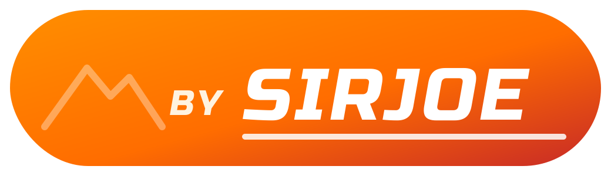

# SirJoe MTB

Ciclocomputer e navigatore per mountain bike su Android: mappa a tutto schermo, cursore "bici vista da dietro" con freccia che segue il percorso, creazione di percorsi personalizzati, tracce in tutti i formati principali e condivisione su Strava, app e social. Progetto personale, gratuito e open source, **non destinato alla vendita**.

> ⚠️ Prima di usare l'app leggi le [Avvertenze d'uso](AVVERTENZE.md). L'app le mostra al primo avvio e vanno accettate.

## Pagine

| Pagina | Cosa fa |
| --- | --- |
| **Mappa** | Mappa a tutto schermo (OpenTopoMap o OpenStreetMap) con itinerari MTB. Cursore: MTB vista da dietro con una freccia davanti che indica dove andare. Mappa orientata nella direzione di marcia, con la posizione nella parte bassa dello schermo. Barra dati in basso: velocità, distanza, ora. Registrazione, avviso di fuori percorso con vibrazione, distanza al traguardo. |
| **Crea** | Percorsi personalizzati: tocca la mappa (o usa "+" col mirino) per aggiungere punti. I tratti seguono strade e sentieri reali (BRouter) oppure vanno in linea retta. Annulla, chiudi anello, inverti, salva, segui subito, condividi. Mostra km e dislivello. |
| **Dati** | Velocità attuale, media e massima, distanza, tempi, ora, quota, dislivello, pendenza, direzione, distanza al traguardo, precisione GPS, profilo altimetrico. |
| **Percorsi** | Archivio di uscite e percorsi. Importa, esporta, rinomina, modifica nella pagina Crea, condividi. Esporta tutto in un archivio ZIP. Mappe offline. |
| **Info** | Impostazioni, collegamento a Strava, avvertenze, crediti. |

## Mappe offline

L'app legge le mappe vettoriali gratuite **[OpenAndroMaps](https://www.openandromaps.org)** (formato Mapsforge `.map`) con lo stile **Elevate**, impostato automaticamente sulla variante MTB: sentieri con difficoltà, curve di livello, itinerari ciclabili, tutto senza Internet.

1. Su openandromaps.org scarica la mappa della tua zona (Europa → Italia, file `.zip` per Android/Mapsforge) e lo stile Elevate (`.zip`). Meglio col Wi-Fi: le mappe regionali pesano centinaia di MB.
2. Nell'app: **Percorsi → Mappe offline → Importa**, prima la mappa e poi lo stile.
3. Dal pulsante mappe (livelli) scegli **Offline: OpenAndroMaps**.

Sono supportati anche file MBTiles/.sqlite/.gemf a immagini. Inoltre le zone viste online restano in memoria (fino a circa 1 GB) e si vedono anche senza segnale.

## Formati

| Formato | Importa | Esporta | Per chi |
| --- | --- | --- | --- |
| GPX | ✓ | ✓ | Komoot, Strava, Wikiloc, Outdooractive, RideWithGPS, quasi tutte le app |
| FIT | ✓ | ✓ (percorso) | Ciclocomputer Garmin Edge, Wahoo, Hammerhead |
| TCX | ✓ | ✓ | Garmin Connect, Strava |
| KML / KMZ | ✓ | KML | Google Earth, Google My Maps |
| GeoJSON | ✓ | ✓ | Siti web e programmi GIS |
| CSV | ✓ | ✓ | Fogli di calcolo |
| ZIP | ✓ (più tracce) | ✓ (tutte le tracce) | Backup e invio in blocco |

Puoi anche aprire un file traccia direttamente da file manager, email, WhatsApp o Telegram con **"Apri con" / "Condividi" → SirJoe MTB**.

## Condivisione

Da **Percorsi → traccia → Condividi**, oppure dal pulsante **Condividi** nella pagina Crea:

- **Carica su Strava**: le uscite registrate vengono pubblicate come attività sul tuo profilo (vedi sotto come collegare Strava).
- **Immagine per i social**: un'immagine con la forma del percorso, i numeri principali e il logo, con testo e hashtag pronti, per Instagram, Facebook, WhatsApp, Telegram, X e simili.
- **File per app e piattaforme**: scegli il formato e invialo a Komoot, Garmin Connect, Wahoo, Wikiloc, email, Drive… (compaiono le app installate che accettano il file).
- **Salva su file** nel telefono.

### Collegare Strava (una volta sola)

Strava permette il caricamento solo tramite un'"applicazione API" personale, gratuita:

1. Da browser vai su **strava.com/settings/api** e crea un'applicazione (nome a piacere, sito anche `https://github.com`).
2. In **Authorization Callback Domain** scrivi `localhost`.
3. Nell'app: **Info → Collega Strava**, incolla **Client ID** e **Client Secret** e autorizza.

Client ID e Secret restano solo sul telefono. Strava accetta come attività solo le uscite registrate (con orari); i percorsi creati a mano si condividono come file GPX.

## Installazione

1. Vai su **Releases** (o su **Actions** → ultima esecuzione → artefatto **SirJoeMTB-apk**) e scarica `SirJoeMTB.apk`.
2. Aprilo sul telefono e consenti l'installazione da questa fonte. Per aggiornare installa il nuovo APK sopra il vecchio: tracce e impostazioni restano.
3. Al primo avvio accetta le avvertenze e concedi posizione e notifiche.

Requisiti: Android 8.0 o superiore, GPS, Google Play Services.

## Compilare in locale

Apri la cartella con Android Studio e premi *Run*. Da riga di comando, con Gradle 8.10+ e JDK 17: `gradle assembleDebug`. I test (`gradle testDebugUnitTest`) verificano scrittura e lettura del formato FIT; GitHub Actions controlla inoltre i file con la libreria indipendente `fitparse`.

## Dati e crediti

- Dati cartografici © [OpenStreetMap contributors](https://www.openstreetmap.org/copyright), licenza ODbL.
- Stile mappa [OpenTopoMap](https://opentopomap.org) (CC-BY-SA). Itinerari MTB: [waymarkedtrails.org](https://mtb.waymarkedtrails.org).
- Calcolo dei percorsi: [BRouter](https://brouter.de) (server pubblico).
- Mappe offline: [OpenAndroMaps](https://www.openandromaps.org) e stile Elevate (scaricati dall'utente, secondo le loro condizioni); motore [Mapsforge](https://github.com/mapsforge/mapsforge).
- Libreria mappe: [osmdroid](https://github.com/osmdroid/osmdroid) (Apache 2.0).
- Carattere del logo: Russo One di Jovanny Lemonad, [SIL Open Font License](docs/licenses/OFL-RussoOne.txt).
- Strava e gli altri nomi citati sono marchi dei rispettivi proprietari; il progetto non è affiliato a loro.

I server gratuiti di mappe e calcolo percorsi sono gestiti da volontari: l'app si identifica, salva in cache solo ciò che visualizzi, fa una sola richiesta di calcolo per ogni punto aggiunto e **non scarica aree intere in blocco**.

## Licenza

Codice rilasciato con licenza [MIT](LICENSE), senza alcuna garanzia. Vedi anche le [Avvertenze d'uso](AVVERTENZE.md).
